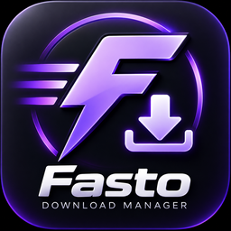
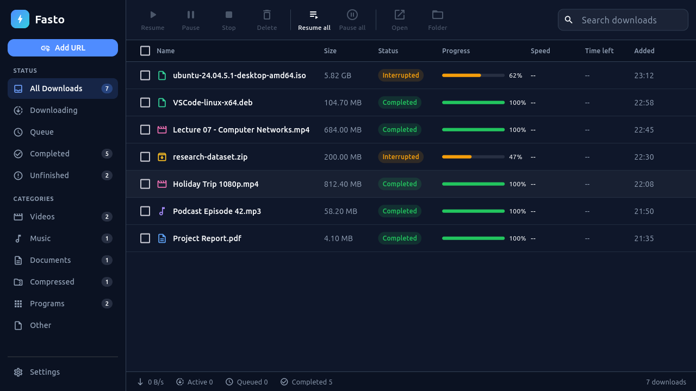

# Fasto Download Manager

<p align="center">
  
</p>

<p align="center">
  <strong>Fast downloads. Less waiting.</strong><br>
  A free download manager for Linux and Windows — multi-connection downloads, pause and resume, video grabbing, torrents and browser integration.
</p>

<p align="center">
  <a href="https://github.com/Tanzeel0Hussain/Fasto/releases/latest"><strong>Download the latest release</strong></a>
  ·
  <a href="https://tanzeel0hussain.github.io/Fasto/">Website</a>
  ·
  <a href="https://chromewebstore.google.com/detail/nbpieehnohklopikjenojedfnpfnlnip">Chrome extension</a>
  ·
  <a href="https://microsoftedge.microsoft.com/addons/detail/bddofecekmcbaneoihhpnebiimcldjec">Edge extension</a>
</p>

<p align="center">
  
</p>

## What's new in 1.2.0

- **Download audio as MP3** — straight from the video menu.
- **Downloads behind a sign-in** — your browser session goes with each download, so files from sites you're logged in to work in Fasto too.
- **Download all links** — pick files from a page in a list and send them to the queue at once.
- **New extension popup** — connection status, capture and video-button switches, videos on the page.
- **Alt+click** a link to keep that download in the browser.

Also in 1.1: redesigned app, torrents and magnet links, speed limit, clipboard watch, clear error messages.

## Download

| Platform | File |
|---|---|
| **Windows 10/11 x64** — installer | [Fasto-Setup-v1.0.0.exe](https://github.com/Tanzeel0Hussain/Fasto/releases/latest/download/Fasto-Setup-v1.0.0.exe) |
| Windows x64 — portable | [Fasto-Windows-x86_64.zip](https://github.com/Tanzeel0Hussain/Fasto/releases/latest/download/Fasto-Windows-x86_64.zip) |
| **Ubuntu 24.04 / Debian x64** — package | [Fasto-Linux-amd64.deb](https://github.com/Tanzeel0Hussain/Fasto/releases/latest/download/Fasto-Linux-amd64.deb) |
| Linux x64 — portable | [Fasto-Linux-x86_64.tar.gz](https://github.com/Tanzeel0Hussain/Fasto/releases/latest/download/Fasto-Linux-x86_64.tar.gz) |
| Checksums | [SHA256SUMS.txt](https://github.com/Tanzeel0Hussain/Fasto/releases/latest/download/SHA256SUMS.txt) |

Installer file names say `v1.0.0` (the wrapper name is fixed); the app inside is the release version. Fasto checks for new versions at startup.

## Features

- **Multi-connection engine** — up to 32 parallel segments, falls back to one connection when a server needs it.
- **Pause, resume, recover** — continue later, even after a restart; dropped connections and rate limits are retried.
- **Video grabber** — "Download this video" on supported pages; pick a quality, or **download the audio as MP3**. Uses the bundled yt-dlp and FFmpeg.
- **HLS / DASH** streams.
- **Torrents & magnet links.**
- **Browser takeover** — downloads started in Chrome, Edge or Brave move to Fasto, with your sign-in, so protected downloads work. Alt+click to skip.
- **Download all links** — from a page or a selection, chosen in a list.
- **Speed limit, clipboard watch, category folders** (Videos, Music, Documents, Compressed, Programs).
- **Queue & bulk control** — choose how many run at once; resume all, pause all.
- **Private by design** — no ads, no account, no analytics.

## Install

### Windows

1. Download and run `Fasto-Setup-v1.0.0.exe`. It installs for your user only — no administrator rights needed.
2. Start Fasto from the Start menu.
3. Optional: install the Chrome or Edge extension (links above).

Portable: extract `Fasto-Windows-x86_64.zip` and run `fasto.exe`. Keep the whole folder together.

### Ubuntu / Debian

```bash
sudo apt install ./Fasto-Linux-amd64.deb
sudo apt install ffmpeg        # for video merging
```

Start **Fasto** from your app menu. On first start it connects itself to Chrome, Chromium, Brave, Edge, Vivaldi and Opera; then install the extension and restart the browser. Fasto is registered as an app for magnet links, so your browser can hand them to it.

### Linux portable

```bash
grep '  Fasto-Linux-x86_64.tar.gz$' SHA256SUMS.txt | sha256sum -c -
tar -xzf Fasto-Linux-x86_64.tar.gz
cd Fasto-Linux-x86_64 && ./fasto
```

Needs GTK 3, SQLite 3, OpenSSL 3, Python 3 and xdg-utils (present on most desktops). Keep the folder in a permanent place: the browser integration points to it.

## Requirements

| | Windows | Linux |
|---|---|---|
| Architecture | x86_64 | x86_64 |
| Video merging | FFmpeg / ffprobe on `PATH` | `sudo apt install ffmpeg` |
| Browser integration | Chrome, Edge, Brave (Chromium-based) | Chrome, Chromium, Brave, Edge, Vivaldi, Opera |

macOS is not supported yet.

## Security & privacy

- Release packages are built by GitHub Actions and scanned for private paths, tokens and keys before publishing.
- Every release lists SHA-256 checksums in `SHA256SUMS.txt`.
- Fasto only contacts the sites you download from and GitHub (update checks, video tooling).

This repository hosts the website and release binaries. Fasto's application source is not published here.

## License

Fasto is distributed under the included **Fasto Download Manager Proprietary License**. Third-party components (such as yt-dlp) remain under their own licenses, included in the release packages.

---

<p align="center"><strong>Fasto — Download faster on Linux and Windows.</strong></p>
